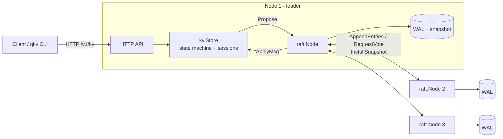

# quorumkv

[](https://github.com/kunwar-dev/quorumkv/actions/workflows/ci.yml)
[](https://pkg.go.dev/github.com/kunwar-dev/quorumkv)

A strongly consistent, fault-tolerant distributed key-value store built on a from-scratch implementation of the **Raft** consensus algorithm in Go.

A quorumkv cluster keeps serving reads and writes as long as a majority of nodes are up, never loses an acknowledged write, and gives **linearizable** semantics: every client sees a single, real-time-ordered history of operations. The core uses only the Go standard library.

```
$ qkv put greeting "hello raft"
$ kill -9 <leader pid>          # crash the leader
$ qkv put after-crash survived  # new leader elected; write succeeds in ~0.6s
$ qkv get greeting
hello raft
```

## Features

- **Raft consensus**: leader election, log replication, the leader no-op commit rule (§5.4.2), and accelerated log backtracking using conflict term hints.
- **Pipelined replication with batching**: one replicator per follower, with a single RPC in flight and proposals coalesced into the next `AppendEntries`.
- **Group commit**: the leader writes to disk in parallel with replication (§10.2.1), batching concurrent writes into one `fsync`. This raised write throughput 3.4x.
- **Durable write-ahead log**: CRC-32C checksummed records, `fsync` on every acknowledgement, torn-write detection and truncation on recovery, and atomic snapshot installation.
- **Log compaction**: snapshots, plus `InstallSnapshot` for followers that fall too far behind.
- **Linearizable KV API**: every operation, reads included, is ordered through the log.
- **Exactly-once retries**: per-client sessions deduplicate retried requests, and the sessions survive snapshots.
- **Operational features**: leader redirects (`307`), Prometheus `/metrics`, `/v1/status`, structured logging, graceful shutdown, Docker Compose cluster, and CI with the race detector.

## Architecture



A write is proposed to the leader's Raft log, replicated to followers, and acknowledged once a majority has it on disk. Every node then applies it, in log order, to its state machine. See [docs/DESIGN.md](docs/DESIGN.md) for details.

| Package | Responsibility |
|---|---|
| [`raft`](raft) | Consensus: elections, replication, commitment, snapshots. Transport- and storage-agnostic. |
| [`wal`](wal) | Crash-safe on-disk `raft.Storage`: checksummed log, recovery, compaction. |
| [`kv`](kv) | Replicated state machine, exactly-once sessions, commit tracking. |
| [`transport`](transport) | Raft RPCs over HTTP with connection pooling and deadlines. |
| [`server`](server) | Wires everything into a node; HTTP API, status and metrics. |
| [`client`](client) | Go client with leader tracking, failover and safe retries. |
| [`internal/memnet`](internal/memnet) | In-memory network for fault-injection tests: partitions, loss, delay. |
| [`cmd/quorumkv`](cmd/quorumkv), [`cmd/qkv`](cmd/qkv) | Server binary; CLI and load generator. |

## Quick start

**Local cluster** (Go 1.22+):

```sh
make cluster                       # 3 nodes on 127.0.0.1:7001-7003
./bin/qkv put user/42 '{"name":"Ada"}'
./bin/qkv get user/42
./bin/qkv status
make stop-cluster
```

**Docker Compose** (3 nodes and Prometheus):

```sh
docker compose up -d --build
docker compose exec n1 qkv -endpoints n1:7001,n2:7001,n3:7001 put hello world
docker compose stop n2             # the cluster keeps serving with 2 of 3 nodes
```

## HTTP API

| Method | Path | Result |
|---|---|---|
| `PUT` | `/v1/kv/{key}` | Store the request body (up to 1 MiB) → `204` |
| `GET` | `/v1/kv/{key}` | Value → `200`, or `404` |
| `DELETE` | `/v1/kv/{key}` | `204`, or `404` if the key did not exist |
| `GET` | `/v1/status` | Node role, term, leader, commit/applied/snapshot indexes |
| `GET` | `/metrics` | Prometheus metrics |

- A follower answers `307 Temporary Redirect` with `Location` pointing at the leader.
- During an election, nodes answer `503` with `Retry-After`.
- To get exactly-once semantics, send `X-Client-Id` and an increasing `X-Request-Seq`, and reuse the same pair when retrying. The Go client does this automatically.

## Correctness and testing

Consensus bugs tend to appear only under rare interleavings, so most of the test suite runs real clusters on [`internal/memnet`](internal/memnet), a simulated network that can isolate nodes, drop 10% of messages and reorder them with random delays.

- **Raft scenarios**:
  - initial election and re-election after leader failure
  - no progress without a quorum
  - rejoin of a partitioned leader holding uncommitted entries
  - fast backtracking over long divergent logs
  - full-cluster crash and restart
  - snapshot installation for lagging followers
  - the paper's Figure 8 scenario on an unreliable network with repeated leader crashes
- **Safety checks**: the harness verifies state-machine safety on every applied entry. No two nodes may ever apply different commands at the same index.
- **Linearizability**: concurrent clients drive a 5-node cluster while nodes are repeatedly isolated and messages dropped. The recorded history is then checked with the [Porcupine](https://github.com/anishathalye/porcupine) linearizability checker. To confirm the check has teeth, it was run against a deliberately injected stale-read bug and failed on every run.
- **Storage**: torn final records, corrupted checksums, a crash between snapshot install and log rewrite, and a 3-node cluster restarted from disk.
- **End to end**: real HTTP servers and on-disk WALs; the leader is killed, the cluster fails over, and the old leader restarts and catches up.

```sh
make test          # everything, with -race
go test -short ./... # skips the longest scenarios
```

## Performance

These are closed-loop numbers from `qkv bench`. The setup was 3 nodes on one 2-vCPU VM (Intel Xeon @ 2.8 GHz), so client and all three replicas share two cores. Values were 128 bytes, and **`fsync` was enabled on every node**.

| Workload | Clients | Throughput | p50 | p99 |
|---|---|---|---|---|
| 100% writes | 64 | **4,970 req/s** | 11.9 ms | 31.1 ms |
| 50% writes / 50% reads | 32 | 3,920 req/s | 7.5 ms | 19.8 ms |

Group commit made a large difference on the 100%-write workload:

| Write persistence on leader | Throughput | p99 |
|---|---|---|
| Synchronous `fsync` per proposal | 1,466 req/s | 95.5 ms |
| Parallel, batched (group commit) | 4,971 req/s | 31.1 ms |

Reads currently go through the log, which makes them linearizable but just as expensive as writes. See the roadmap.

## Limitations and roadmap

- **Static membership.** The cluster configuration is fixed at startup. Joint-consensus membership changes are planned.
- **Reads use the log.** `ReadIndex` and leader-lease reads would serve linearizable reads without a log append.
- **No pre-vote.** A node that rejoins after a partition can force a needless election by advertising a higher term.
- **Unbounded client sessions.** Session expiry is not yet implemented.
- **Single-key operations only.** There are no transactions or range scans.
- **Plain HTTP between nodes.** mTLS is not yet supported.

## License

[MIT](LICENSE)
